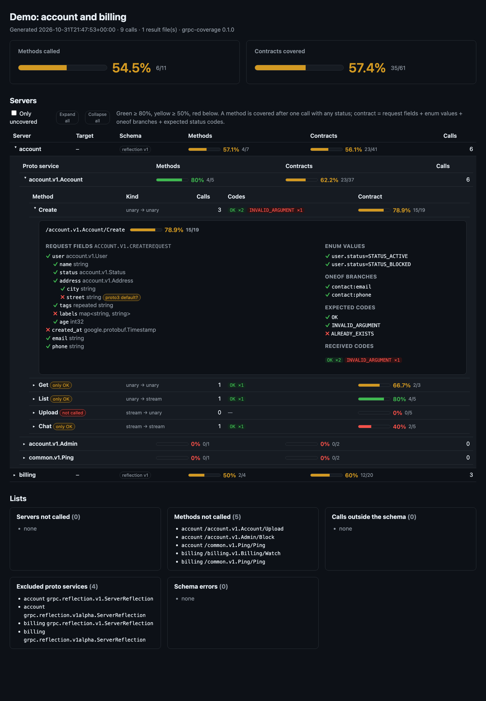

# grpc-coverage

gRPC API coverage for tests: which RPCs the tests called and how thoroughly — request fields, enum values and
oneof branches they sent, status codes that came back. One HTML report and a `coverage.json` for many servers,
built Allure-style: tests write results, the report is a separate command.



<sub>The report of [`examples/demo`](examples/demo): `python examples/demo/run.py`.</sub>

- **Methods:** every RPC of every proto service the server exposes; called or not, with status codes.
- **Contracts:** request fields (`user.address.city`), enum values (`user.status=STATUS_ACTIVE`), oneof branches
  (`contact:email`) and status codes (OK plus the `expected-codes` you declare).
- **Many servers:** each microservice is its own *server* with its own schema snapshot and threshold.
- sync and `grpc.aio` channels, all four call kinds, pytest-xdist, any working directory.

**grpc-coverage only observes.** It is a [`grpc-observer`](https://github.com/ValeriyMenshikov/grpc-observer) on
your channels and never changes requests, responses or metadata. The only requests it makes itself are reflection
requests for the schema: one snapshot per server per test session.

## Install

```
pip install grpc-coverage             # observer, pytest plugin, CLI
pip install "grpc-coverage[proto]"    # also compile .proto files, for servers without reflection
```

Python 3.11+, grpcio 1.65.1+, protobuf 5.26+. pytest is not a dependency: the plugin is registered through the
`pytest11` entry point and switches on only in projects with `[tool.grpc-coverage]` in `pyproject.toml`.

## Servers and proto services

Two words are used throughout:

- **server** — what runs behind one `target`: the `account` microservice, the `billing` microservice. Each has a
  table `[tool.grpc-coverage.<server>]` and its own schema snapshot.
- **proto service** — `account.v1.Account`, a `service` block in a `.proto` file. One server usually exposes several
  of them. The same proto service on two servers (`common.v1.Ping`, a health service) is counted separately for each.

## Quickstart in three steps

The examples use the stubs generated from the `.proto` files of the servers, `account_pb2_grpc.AccountStub` and so
on, exactly as your tests do.

**1. Declare the servers** in `pyproject.toml`:

<!-- file: quickstart/pyproject.toml -->
```toml
[project]
name = "acme-api-tests"

[tool.grpc-coverage]

[tool.grpc-coverage.account]

[tool.grpc-coverage.billing]

[tool.grpc-coverage.billing.expected-codes]
"/billing.v1.Billing/Charge" = ["INVALID_ARGUMENT"]  # a negative test is part of the contract
```

**2. Put the observer on the channel and take the schema** in the fixture that creates the channel:

<!-- file: quickstart/tests/conftest.py -->
```python
import os

import grpc
import pytest
from account.v1 import account_pb2_grpc
from billing.v1 import billing_pb2_grpc

from grpc_coverage import CoverageObserver


def coverage_channel(server: str, target: str):
    coverage = CoverageObserver(server)  # the name of a [tool.grpc-coverage.<server>] table
    channel = grpc.intercept_channel(grpc.insecure_channel(target), coverage.interceptor())
    coverage.snapshot(channel)  # the schema, by reflection; once per server per session
    return channel


@pytest.fixture(scope="session")
def account():
    channel = coverage_channel("account", os.environ.get("ACCOUNT_TARGET", "localhost:50051"))
    yield account_pb2_grpc.AccountStub(channel)
    channel.close()


@pytest.fixture(scope="session")
def billing():
    channel = coverage_channel("billing", os.environ.get("BILLING_TARGET", "localhost:50052"))
    yield billing_pb2_grpc.BillingStub(channel)
    channel.close()


@pytest.fixture(scope="session", autouse=True)
def grpc_schemas(account, billing):
    """Schemas of all servers, even when `pytest -k` selects tests of one of them (see below)."""
```

The tests stay as they are:

<!-- file: quickstart/tests/test_account.py -->
```python
import grpc
import pytest
from account.v1 import account_pb2


def test_create(account):
    user = account_pb2.User(name="ann", status=account_pb2.STATUS_ACTIVE)
    assert account.Create(account_pb2.CreateRequest(user=user, email="ann@example.com")).id == "u-ann"


def test_get_missing(account):
    with pytest.raises(grpc.RpcError) as error:
        account.Get(account_pb2.GetRequest(id="missing"))
    assert error.value.code() == grpc.StatusCode.NOT_FOUND


def test_list(account):
    assert len(list(account.List(account_pb2.ListRequest(limit=3)))) == 3
```

<!-- file: quickstart/tests/test_billing.py -->
```python
import grpc
import pytest
from billing.v1 import billing_pb2


def test_charge(billing):
    money = billing_pb2.Money(units=100, currency=billing_pb2.CURRENCY_EUR)
    request = billing_pb2.ChargeRequest(account_id="u-ann", amount=money, wallet="w-1")
    assert billing.Charge(request).charge_id


def test_charge_zero(billing):
    with pytest.raises(grpc.RpcError) as error:
        billing.Charge(billing_pb2.ChargeRequest(account_id="u-ann"))
    assert error.value.code() == grpc.StatusCode.INVALID_ARGUMENT
```

**3. Run the tests and build the report:**

<!-- run: quickstart -->
```shell
pytest
grpc-coverage report
```

<!-- output: quickstart -->
```text
account   methods 3/7 (42.9%)    contracts 10/38 (26.3%)
billing   methods 1/4 (25%)      contracts 9/20 (45%)
total     methods 4/11 (36.4%)   contracts 19/58 (32.8%)
```

Open `grpc-coverage-report/index.html`. The report needs no running servers: the schemas are saved next to the
results, so it can be built later, in another CI job or from a downloaded artifact. Rows open into proto services,
services into methods, a method into its card; `index.html#account/account.v1.Account/Create` links straight to it.

What the files are:

```
grpc-coverage-results/        results-dir, written by the tests
  calls/<pid>-<uuid>.jsonl    one file per test process, one line per call
  schema/account.binpb        FileDescriptorSet of the server, from reflection
  schema/account.json         who took the snapshot, when, from which target, sha256, proto services
grpc-coverage-report/         report-dir, written by `grpc-coverage report`
  index.html                  one static file: CSS, JS and data inside, no network needed
  coverage.json               the same numbers for badges and merge-request comments
```

Add both folders to `.gitignore`.

## Taking the schema

Coverage is counted against the schema of the running server, so every server needs a snapshot. There are three
ways to take one; each server is snapshotted once per session, an existing snapshot is never retaken.

| how | when to use |
|---|---|
| `coverage.snapshot(channel)` / `await coverage.asnapshot(channel)` in the fixture that creates the channel | **The default.** It goes through your channel with all your interceptors: auth, TLS, runtime tokens. Works for servers started by a fixture. |
| `target` in `[tool.grpc-coverage.<server>]` | The address is known before the session and static metadata (an API key) is enough. The pytest plugin snapshots all such servers in parallel at session start, in the xdist controller only. |
| `grpc-coverage snapshot` | Outside pytest: before tests written in another language, or to refresh a snapshot with `--force`. Uses `target` too. |

The plugin and the CLI never fail the run: a server that can't be reached gets `schema/<server>.error` with the
code and the message, and the other servers are snapshotted as usual. `snapshot(channel)` later in the session
still takes the snapshot and removes the marker; whatever remains is shown in the report.

### A token you get at runtime

Tokens from a login call expire and rotate, so they can't go into `pyproject.toml`. The plugin then gets
`UNAUTHENTICATED` by `target` (the run goes on, the header says the snapshot is deferred) and the fixture takes it
through the channel that has the token. Put the observer **after** the auth interceptor so it sees what is really
sent:

<!-- file: token/pyproject.toml -->
```toml
[tool.grpc-coverage]

[tool.grpc-coverage.account]
target = "${ACCOUNT_TARGET:-localhost:50051}"
```

<!-- file: token/tests/conftest.py -->
```python
import os

import grpc
import pytest
from account.v1 import account_pb2_grpc
from auth.v1 import auth_pb2, auth_pb2_grpc

from grpc_coverage import CoverageObserver

TARGET = os.environ.get("ACCOUNT_TARGET", "localhost:50051")


class TokenInterceptor(
    grpc.UnaryUnaryClientInterceptor,
    grpc.UnaryStreamClientInterceptor,
    grpc.StreamUnaryClientInterceptor,
    grpc.StreamStreamClientInterceptor,
):
    """Logs in on the first call and again every 50 calls: the token expires."""

    def __init__(self, login):
        self.login, self.token, self.calls = login, None, 0

    def _with_token(self, details):
        if self.token is None or self.calls % 50 == 0:
            self.token = self.login()
        self.calls += 1
        return details._replace(metadata=[*(details.metadata or ()), ("authorization", self.token)])

    def intercept_unary_unary(self, continuation, details, request):
        return continuation(self._with_token(details), request)

    def intercept_stream_unary(self, continuation, details, request_iterator):
        return continuation(self._with_token(details), request_iterator)

    intercept_unary_stream = intercept_unary_unary
    intercept_stream_stream = intercept_stream_unary


@pytest.fixture(scope="session")
def account():
    raw = grpc.insecure_channel(TARGET)

    def login():
        return auth_pb2_grpc.AuthStub(raw).Login(auth_pb2.LoginRequest(user="qa-bot")).token

    coverage = CoverageObserver("account")
    channel = grpc.intercept_channel(raw, TokenInterceptor(login), coverage.interceptor())
    coverage.snapshot(channel)  # reflection with the token; removes schema/account.error left by the plugin
    yield account_pb2_grpc.AccountStub(channel)
    raw.close()
```

<!-- file: token/tests/test_account.py -->
```python
from account.v1 import account_pb2


def test_get(account):
    assert account.Get(account_pb2.GetRequest(id="u-1")).name == "u-1"
```

<!-- run: token -->
```shell
pytest
grpc-coverage report
```

The reflection requests go through the same interceptors but are not counted as calls of the tests.

### `grpc.aio` channels

Use `await coverage.asnapshot(channel)` and `aio_interceptors()` (a list). An aio channel belongs to the event loop
it was created in, so create it in an async session fixture that runs in the same loop as the tests; with
pytest-asyncio that is `loop_scope="session"` on both (anyio works the same way):

<!-- file: aio/pyproject.toml -->
```toml
[tool.grpc-coverage]

[tool.grpc-coverage.account]
```

<!-- file: aio/tests/conftest.py -->
```python
import os

import grpc
import pytest_asyncio
from account.v1 import account_pb2_grpc

from grpc_coverage import CoverageObserver


@pytest_asyncio.fixture(scope="session", loop_scope="session")
async def account():
    coverage = CoverageObserver("account")
    target = os.environ.get("ACCOUNT_TARGET", "localhost:50051")
    async with grpc.aio.insecure_channel(target, interceptors=coverage.aio_interceptors()) as channel:
        await coverage.asnapshot(channel)
        yield account_pb2_grpc.AccountStub(channel)
```

<!-- file: aio/tests/test_account.py -->
```python
import pytest
from account.v1 import account_pb2


@pytest.mark.asyncio(loop_scope="session")
async def test_get(account):
    assert (await account.Get(account_pb2.GetRequest(id="u-1"))).name == "u-1"


@pytest.mark.asyncio(loop_scope="session")
async def test_list(account):
    assert len([user async for user in account.List(account_pb2.ListRequest(limit=2))]) == 2
```

<!-- run: aio -->
```shell
pytest
grpc-coverage report
```

`asnapshot` waits at most `reflection-timeout`; cancelling the task from outside propagates `CancelledError`.
`snapshot(aio_channel)` and `asnapshot(sync_channel)` raise `TypeError`.

### Why the schema fixture is `autouse=True`

A server whose fixture never ran has no snapshot, and the report can only say *no schema* instead of showing 0%.
With `pytest -k account` no billing test is selected, so the `billing` fixture would not run. The autouse
`grpc_schemas` fixture of the quickstart requests every channel fixture, so all servers are snapshotted in every
run:

<!-- run: quickstart -->
```shell
grpc-coverage clean
pytest -k account
grpc-coverage report
```

<!-- output: quickstart -->
```text
account   methods 3/7 (42.9%)    contracts 10/38 (26.3%)
billing   methods 0/4 (0%)       contracts 0/20 (0%)       not called
```

With `target` in the toml the plugin snapshots such servers anyway.

## The report at the end of the session

`grpc-coverage report` is the way to build the report. For local runs the plugin can do it after the tests:

```toml
[tool.grpc-coverage]
report-on-finish = true    # or `pytest --grpc-coverage-report` for one run
```

The summary is printed in the `grpc-coverage` section at the end of the pytest output. It is the same code as
`grpc-coverage report` and it never changes the pytest exit code: thresholds are checked by `grpc-coverage report`,
so low coverage is a separate CI step, not a failed test.

Why not build the report in the teardown of a session fixture: under xdist every worker has its own session and
finishes on its own, so a worker's teardown sees only part of the calls and races with the others. Only the xdist
controller knows that all workers are done; `report-on-finish` runs there, once.

## What is counted

**Methods.** Every RPC of every proto service in the server's schema, minus `exclude` (reflection and health
services by default). A method is covered if it was called at least once, whatever the status. Methods that only
ever returned `OK` are marked *only OK*: no negative check. Calls to methods that are not in the schema (a stale
snapshot, a wrong server name) are listed separately; calls with a server name that has no table, too.

**Contracts** of a method, each item is covered or not:

1. **request fields** — a path like `user.address.city`; covered if it was set in at least one request
   (`message.ListFields()`);
2. **enum values** of every enum field of the request — `user.status=STATUS_ACTIVE`; the zero value
   (`*_UNSPECIFIED`) is not counted: in proto3 it can't be told from an unset field;
3. **oneof branches** — `contact:email`;
4. **status codes** — `OK` and the codes from `expected-codes` of the method.

How requests are walked:

- nested messages are walked recursively: `user`, `user.address`, `user.address.city`;
- a recursive type is cut where it repeats on the path: `tree`, `tree.name`, `tree.children`, not
  `tree.children.children`;
- `repeated` and `map` fields are covered when not empty; messages inside them are walked without an index:
  `items.price`, the values of `map<string, Address>` as `addresses.city`;
- well-known types (`google.protobuf.Timestamp`, wrappers, `Struct`, …) are leaves;
- the synthetic oneof of a proto3 `optional` field is not a oneof of the contract;
- for streaming requests every message counts.

**The proto3 limitation.** A proto3 field without `optional` that holds its default (`0`, `""`, `false`, the zero
enum) is not on the wire, so it can't be seen and stays not covered. This is deliberate. Such fields are marked
*proto3 default* in the method card; declare them `optional` if sending the default is a meaningful case.

Percentages: per proto service, per server and in total, as covered items / all items, separately for methods and
contracts. Colours: green ≥ 80%, yellow ≥ 50%, red below; the number is always shown next to the colour.

## Where the schema comes from

For every server, in this order:

1. **the snapshot** in `results-dir/schema/` (reflection v1, or v1alpha for older servers);
2. **an error marker** (`.error`): the report shows the error — `proto` is *not* used;
3. **`proto`** of the server, compiled with `grpcio-tools` (`grpc-coverage[proto]`): only when reflection is
   disabled on the server (`.reflection-disabled`) or no snapshot was attempted;
4. otherwise *no schema* with what to do about it, and `grpc-coverage report` exits with 1.

Reflection describes exactly the build that answered the calls; `.proto` files in the test repository drift from
what is deployed. When reflection failed for another reason (the server was down, no token), a silent fallback
to `proto` would count coverage against a schema that may not match, so the report says what went wrong instead.
Several results dirs with *different* snapshots of one server (two versions of the service) are an error too, with
both targets and times. A snapshot whose `.binpb` is missing or doesn't match the sha256 in its `.json` (a partial
copy of an artifact) is an error of that server too, `SNAPSHOT_INCOMPLETE`, not *no schema*.

## Configuration

Everything lives in the `pyproject.toml` of the project. It is found from the file that creates the observer (or
from pytest's `rootdir` for the plugin) upwards, skipping `pyproject.toml` files without `[tool.grpc-coverage]`;
the CLI looks from the current directory or takes `--config`. Relative paths are relative to that
`pyproject.toml`, never to the current directory: `os.chdir` in a test or another `working-directory` in CI
changes nothing.

### `[tool.grpc-coverage]`

| key | type | default | meaning |
|---|---|---|---|
| `results-dir` | path | `grpc-coverage-results` | where the tests write calls and schemas; env `GRPC_COVERAGE_RESULTS_DIR` |
| `report-dir` | path | `grpc-coverage-report` | where the report goes; env `GRPC_COVERAGE_REPORT_DIR`, flag `--report-dir` |
| `title` | string | `[project] name` | the report title |
| `exclude` | list of globs | `["grpc.reflection.*", "grpc.health.*"]` | proto services not counted, on every server |
| `fail-under` | number 0–100 | none | minimum method coverage of every server and of the total; env `GRPC_COVERAGE_FAIL_UNDER`, flag `--fail-under` |
| `fail-under-contracts` | number 0–100 | none | the same for contracts; flag `--fail-under-contracts` |
| `reflection-timeout` | seconds | `10` | for one snapshot |
| `report-on-finish` | bool | `false` | build the report at the end of the pytest session |

Priority: command-line flag → environment variable → `pyproject.toml` → default.

### `[tool.grpc-coverage.<server>]`

One table per server; the order of the tables is the order in the report. The name may contain latin letters,
digits, `-` and `_`. An empty table is fine: the snapshot then comes from `snapshot(channel)`.

| key | type | default | meaning |
|---|---|---|---|
| `target` | string | none | address for the plugin and `grpc-coverage snapshot` |
| `tls` | bool | `false` | use a TLS channel for `target` |
| `root-cert` | path | system roots | CA certificate for `tls` |
| `metadata` | table of strings | none | static metadata for reflection by `target` (an API key, a tenant) |
| `proto` | path or list of paths | none | `.proto` files or folders, used only without reflection |
| `proto-include` | list of paths | none | import paths for `proto` |
| `include` | list of globs | all | count only these proto services |
| `exclude` | list of globs | none | added to the common `exclude` |
| `fail-under` | number 0–100 | common value | method threshold of this server, overrides the common one |
| `fail-under-contracts` | number 0–100 | common value | contract threshold of this server |

`[tool.grpc-coverage.<server>.expected-codes]` maps full method names to the status codes that are part of their
contract besides `OK`:

```toml
[tool.grpc-coverage.account.expected-codes]
"/account.v1.Account/Create" = ["INVALID_ARGUMENT", "ALREADY_EXISTS"]
```

Unknown keys, wrong types, unknown status codes and server keys at the top level are errors that name the key.

### Environment variables in values

Server values may use `${VAR}` and `${VAR:-default}`: stand addresses differ between CI and laptops, and secrets
don't belong in the toml.

```toml
[tool.grpc-coverage.account]
target = "${ACCOUNT_GRPC_TARGET:-localhost:50051}"
metadata = { x-api-key = "${ACCOUNT_API_KEY}", x-tenant = "${TENANT:-acme}" }
```

An unset variable without a default breaks only its own server (its snapshot by `target` fails with `ENV`), not
the session: locally not every server is usually up. Only static values go here. Tokens that are fetched or
refreshed at runtime are not written into the toml: take the snapshot of such servers in the fixture, as above.

## Cleaning `results-dir`

Results accumulate across runs until removed, like Allure results; that is what lets several runs or jobs add up.
Start a fresh measurement with

<!-- run: quickstart -->
```shell
grpc-coverage clean
```

It removes only what grpc-coverage writes (`calls/`, `schema/`) and the folder if it is then empty. Snapshots go
too, so the next session takes them again from the current servers.

## CI

Clean, run the tests, check the thresholds, keep the report as an artifact (GitHub Actions):

<!-- ci: quickstart -->
```yaml
      - run: grpc-coverage clean
      - run: pytest -n 4
      - run: grpc-coverage report --fail-under 25 --fail-under-contracts 25
        if: ${{ !cancelled() }}
      - uses: actions/upload-artifact@v4
        if: ${{ !cancelled() }}
        with:
          name: grpc-coverage-report
          path: grpc-coverage-report
```

`report` exits with `1` if a threshold is not met or a declared server has no schema, and with `2` on a broken
config or unreadable results; `0` otherwise. The summary names the server and the reason.

**Several jobs, one report.** When the tests of different services run in parallel jobs, each job uploads its
`results-dir` and a final job merges them: give `report` all the folders. The merge is a union of what was sent
and a sum of the counters, so the order of the folders does not matter.

<!-- run: quickstart -->
```shell
grpc-coverage clean
GRPC_COVERAGE_RESULTS_DIR=results/account pytest tests/test_account.py
GRPC_COVERAGE_RESULTS_DIR=results/billing pytest tests/test_billing.py
grpc-coverage report results/account results/billing --fail-under 25
```

<!-- output: quickstart -->
```text
total     methods 4/11 (36.4%)   contracts 19/58 (32.8%)
```

## The pytest plugin and the CLI

The plugin is active when a `pyproject.toml` with `[tool.grpc-coverage]` is found from pytest's `rootdir`
upwards. It adds `--grpc-coverage-report` and prints where the results go and how the snapshots went in the session
header (and problems again at the end, since `-q` hides the header).

```
grpc-coverage report [RESULTS_DIR ...] [--report-dir DIR] [--server NAME ...] [--fail-under N]
                     [--fail-under-contracts N] [--format html,json] [--config PATH]
grpc-coverage snapshot [SERVER ...] [--force] [--config PATH]
grpc-coverage clean [--config PATH]
```

## Examples

[`examples/demo`](examples/demo) starts two local servers, runs a small test project against them and builds the
report from the screenshot: `python examples/demo/run.py`.

## Roadmap

Not in 0.1:

- coverage of response fields;
- `serve` / `open` like Allure (a local http server with the report);
- history and coverage diff between runs;
- an Allure widget (`environment.properties` or a link to the report);
- cleaning `results-dir` by the plugin at session start;
- discovering servers without declaring them in the toml;
- server-side coverage and metadata coverage.

## License

MIT
